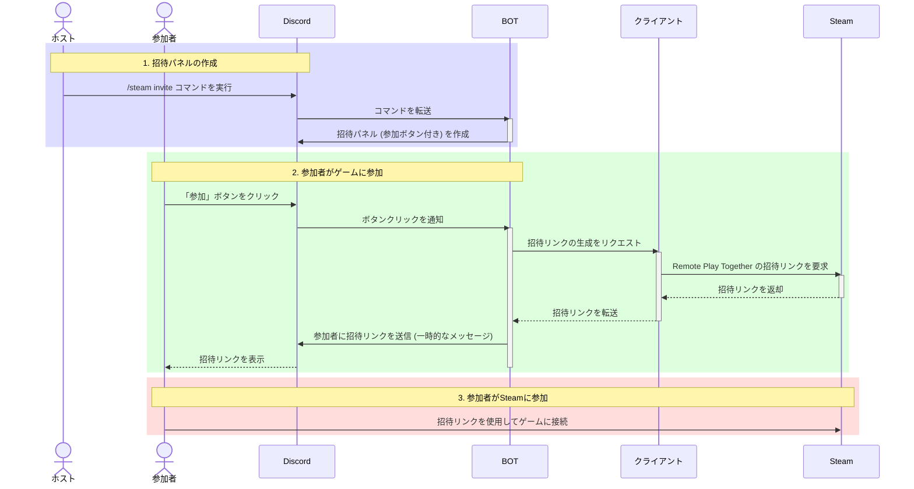

# Steam Remote Play Inviter

**Steam Remote Play Together に、Discord で簡単招待。**
1 人がゲームを持っていれば、参加者は無料で一緒に遊べます。

- 公式サイト: https://steaminviter.app
- BOT をサーバーに追加: [Discord で招待](https://discord.com/oauth2/authorize?client_id=1252429340780527714)
- クライアントのダウンロード: [Releases](https://github.com/Kamesuta/remoteplay-inviter/releases/latest)

## 特長

- **ホストは何もしなくていい**: Discord に招待パネルを一度出すだけ。参加者がボタンを押すたびに、招待リンクが自動で発行されます。公式の Steam クライアントのように、1 人ずつリンクを発行してコピペする手間がありません。
- **参加者は無料**: Steam 公式の Remote Play Together を使うので、ゲームを持っているのはホストだけで OK。参加者はゲームも Steam アカウントも要りません。
- **スマホからも参加できる**: 参加者は Steam Link アプリで、PC だけでなくスマホやタブレットからも遊べます。
- **どのゲームでも**: Remote Play Together に対応したゲームなら何でも使えます。対応していないゲームは BOT が教えてくれます。
- **どのサーバーでも**: サーバーに BOT を入れるか、自分のアカウントにアプリとして追加すれば、DM やグループでも使えます。
- **Windows / macOS / Linux**: クライアントが必要なのはホストだけです。

## 使い方

1. ホストは[クライアント](https://github.com/Kamesuta/remoteplay-inviter/releases/latest)をダウンロードして起動します（Steam は起動しておく）。
2. クライアントに表示されるコマンド `/steam setup client_id:...` を Discord で実行して、Discord アカウントと連携します（クリップボードにコピー済みです）。
3. Remote Play Together に対応したゲームを起動し、Discord で `/steam invite` を実行すると招待パネルが出ます。
4. 参加者はパネルのボタンを押して、届いた招待リンクから参加します。

このツールは非公式です。Remote Play Together は Steam の公式機能ですが、Remote Play Inviter は Valve とは関係ありません。

## 仕組み

ホストの PC で動くクライアントが、BOT に WebSocket でつないで待ち受けます。参加者がボタンを押すと、BOT がクライアントに招待リンクの発行を頼み、Steam が発行したリンクを参加者だけに届けます。

## 構成

| フォルダ | 内容 |
|---|---|
| [`client/`](client/) | ホストの PC で動かすクライアント(Rust)。Steam と連携し、招待リンクを作ります。 |
| [`bot/`](bot/) | Discord Bot(Cloudflare Workers)。`/steam` コマンドと招待ボタンを受け付け、WebSocket でクライアントに指示を送ります。 |
| [`web/`](web/) | 公式サイト(Next.js、Cloudflare Workers)。 |

使い方とビルド方法は、各フォルダの README を見てください。

## CI

GitHub Actions は手動で起動します。

- `Check.yml`: クライアントの fmt / clippy / test(Windows・macOS・Linux)
- `Release.yml`: クライアントのビルドと配布物の作成。`v*` のタグを push するとリリースを作ります。
- `bot-check.yml`: Bot の整形・型検査・lint・テスト

## ライセンス

[MIT](LICENSE)
