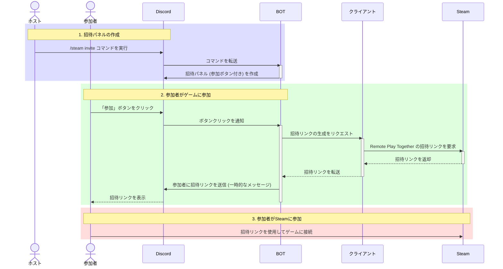

# Steam Remoteplay Inviter BOT

「[Steam Remoteplay Inviter](https://steaminviter.app)」のバックエンドとして動く Discord BOT です。Cloudflare Workers で動きます。

## 概要

このBOTは、Steamの「Remote Play Together」機能を使ったゲームへの招待を、Discordを通じて自動化するためのものです。ホスト（ゲーム主催者）が手動で招待リンクを発行する手間を省き、参加者はDiscordのボタンをクリックするだけで簡単にゲームに参加できます。

## 主な機能

*   **スラッシュコマンド**: Discordの `/steam` コマンド群を提供し、直感的な操作を実現します。
*   **招待パネル**: ゲームへの参加ボタンが付いた招待パネルをDiscord上に作成します。
*   **招待リンクの自動発行**: 参加ボタンが押されると、BOTがホストのクライアントと連携し、自動で招待リンクを発行して参加者に通知します。
*   **多言語対応**: 日本語と英語に対応しています（`locales/`）。

## 構成

| 部分 | 役割 |
| --- | --- |
| Worker (`src/index.ts`) | Discord の Interactions Endpoint (`POST /interactions`)、クライアントの WebSocket 接続、`GET /` のダウンロードページへのリダイレクト |
| Durable Object (`src/daemon/DaemonObject.ts`) | クライアント 1 台につき 1 つ。WebSocket Hibernation API で接続を持ち、クライアントへの問い合わせを中継します |
| D1 (`migrations/`) | Discord ユーザーとクライアントの紐づけ (`UserData`) |
| Cron Trigger | 1 時間ごとに利用状況をログに出します |

- Discord とは Gateway ではなく HTTP の Interactions で通信します。3 秒以内に応答し、時間のかかる処理は応答後に続けます。
- 接続を保つための ping はクライアントが送ります（Workers の実行環境が自動で Pong を返します）。
  BOT からは ping を送らないので、クライアントの PC がスリープするなどして切断の通知なしに途切れると、実行環境が気づくまではオンライン扱いのままです。そのあいだの招待は、オフラインではなく時間切れのエラーになります。
- 同じクライアント ID のクライアントが複数つながっているときは、最後につながったものに問い合わせます。
- クライアントとの通信の形式は `src/daemon/models.ts` と `client/src/models.rs` にあります。

## 開発

### 前提条件

*   [Node.js](https://nodejs.org/) (v22 以上)
*   Cloudflare アカウント（`npx wrangler login` でログイン）

依存パッケージを追加・更新するときは npm 11 以上を使ってください（npm 10 では依存の解決に失敗することがあります。`npm ci` は npm 10 でも動きます）。

```bash
npm ci
```

### ローカルで動かす

```bash
cp .dev.vars.example .dev.vars   # DISCORD_TOKEN と DISCORD_PUBLIC_KEY を書く
npx wrangler d1 migrations apply remoteplay-inviter --local
npm run dev
```

クライアントを `ws://localhost:8787` につなぐには、実行ファイルの隣に `remoteplay-inviter.endpoint.toml`（`url = "ws://localhost:8787"`）を置きます。開発版のクライアントは版が `0.1.0` なので、`npm run dev -- --var DAEMON_REQUIRED_VERSION:0.1.0` で起動してください。

### 確認

```bash
npm run typecheck
npm run lint
npm test
```

### 設定

| 名前 | 種類 | 説明 |
| --- | --- | --- |
| `DISCORD_APPLICATION_ID` | vars | Discord アプリケーションの ID |
| `DAEMON_REQUIRED_VERSION` | vars | 接続を受け付けるクライアントの最低バージョン |
| `DAEMON_DOWNLOAD_URL` | vars | 更新が必要なクライアントに案内するページ |
| `DISCORD_TOKEN` | secret | BOT のトークン（統計とコマンド登録に使う） |
| `DISCORD_PUBLIC_KEY` | secret | Interactions の署名検証に使う公開鍵 |

vars は `wrangler.toml` に、secret は `npx wrangler secret put <名前>` で設定します。

## デプロイ

```bash
npx wrangler d1 migrations apply remoteplay-inviter --remote
npm run deploy
```

Discord Developer Portal の「Interactions Endpoint URL」には `https://<Worker のホスト名>/interactions` を設定します。

### コマンドの登録

コマンドの定義（`src/discord/commands.ts`）を変えたときだけ実行します。

```bash
DISCORD_TOKEN=<BOT のトークン> npm run register
```

## シーケンス図


